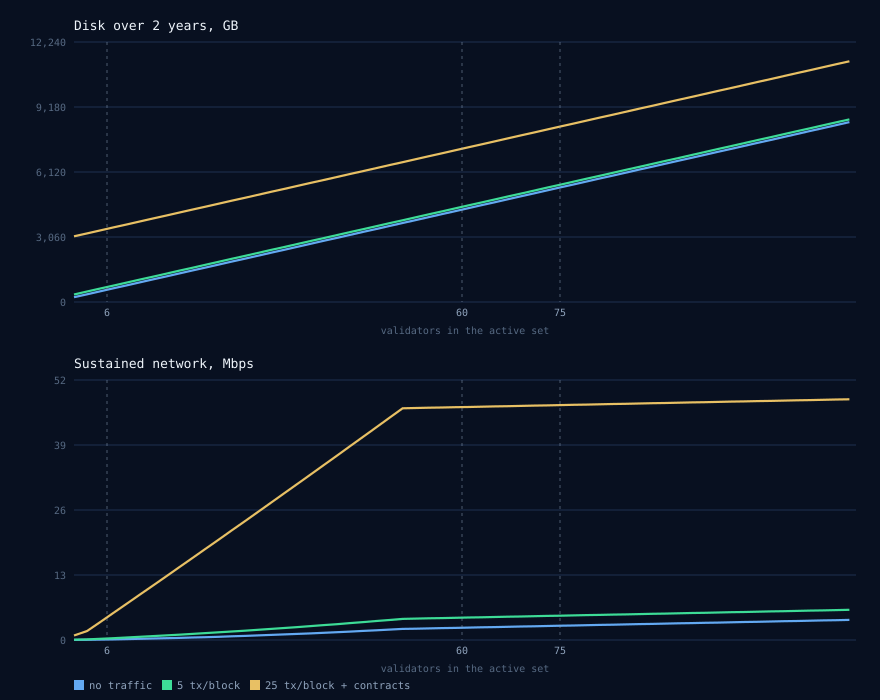

# Running a SAiCoN node — what you need

These are a guide, sized from measurements on a running node with margin on top.
Do your own testing before committing to hardware you cannot change later.

Pick one:

- **Validator** — takes part in consensus and earns rewards. This is what almost
  everyone wants.
- **Full node** — keeps every block, with state pruned to the same window a
  validator keeps. The read tier: enough to answer for any block or transaction
  ever produced, without an archive's disk. Also what a sentry runs. It does not
  validate and does not earn.
- **Archive node** — keeps every block and every historical state, forever. Needed
  only if you serve history: a block explorer, an indexer, audit tooling. It does
  not validate and does not earn.

A validator is not one machine. Running one properly means putting it behind two
sentries, which are full nodes — see *The layout a validator actually needs*, at
the end.

---

## Validator

| Component | DevNet today | At launch (~6 nodes) | Full network (~75 nodes) |
|---|---|---|---|
| **CPU** | 2 cores | 2 cores | 4 cores |
| **CPU clock** | 2.5 GHz+ | 2.8 GHz+ | 3.0 GHz+ |
| **Architecture** | x86-64 or ARM64 | x86-64 or ARM64 | x86-64 or ARM64 |
| **RAM** | 4 GB | 8 GB | 16 GB |
| **Disk** | 20 GB | 50 GB | 300 GB |
| **Disk type** | SSD | SSD | NVMe SSD |
| **Free disk space** | 25% | 25% | 25% |
| **Network speed** | 10 Mbps | 50 Mbps | 100 Mbps symmetric |
| **Monthly traffic** | 10 GB | 100 GB | 3 TB |
| **Open ports** | 26656 | 26656 | 26656 |
| **Operating system** | Linux x64 | Linux x64 | Linux x64 |
| **Uptime target** | none | 99.0% | 99.5% |

**CPU.** Clock speed matters more than core count — the node verifies signatures
and hashes state, and neither parallelises well. Four cores is enough at any size
we currently plan for; the validator count does not change this.

**RAM.** The node itself uses well under a gigabyte today. These figures leave
room for the chain's state to grow, which it will.

**Disk.** The number that grows, and the one to over-buy. Sized for roughly two
years of operation. Keeping 25% free is not optional — the database compacts by
rewriting itself, and a full disk stops the node rather than slowing it.

**Disk type.** Local SSD. Network-attached storage — EBS, NFS, most cloud "block
storage" — is a poor fit: one stalled write costs you a block, and repeated stalls
cost you your place in the active set.

**Network.** Stability matters far more than speed. The node needs a few Mbps
sustained; these figures are margin for bursts and for catching up after downtime.
Unmetered is preferable, since traffic grows with the network.

**Ports.** Only 26656 needs to be reachable from outside — that is the peer-to-peer
port. Keep RPC (26657) and the API (1317) private unless you deliberately intend
to serve them.

---

## Full node

Same shape as a validator for everything except storage, because it does the same
verification work and answers queries on top. Where it differs is the disk, and
that figure is the one being measured rather than guessed.

| Component | DevNet today | At launch (~6 nodes) | Full network (~75 nodes) |
|---|---|---|---|
| **CPU** | 2 cores | 2 cores | 4 cores |
| **CPU clock** | 2.5 GHz+ | 2.8 GHz+ | 3.0 GHz+ |
| **Architecture** | x86-64 or ARM64 | x86-64 or ARM64 | x86-64 or ARM64 |
| **RAM** | 4 GB | 8 GB | 16 GB |
| **Disk** | *pending measurement* | *pending measurement* | *pending measurement* |
| **Disk type** | SSD | SSD | NVMe SSD |
| **Free disk space** | 25% | 25% | 25% |
| **Network speed** | 10 Mbps | 50 Mbps | 100 Mbps symmetric |
| **Monthly traffic** | 10 GB | 100 GB | 3 TB |
| **Open ports** | 26656 + whatever you serve | 26656 + whatever you serve | 26656 + whatever you serve |
| **Operating system** | Linux x64 | Linux x64 | Linux x64 |
| **Uptime target** | none | none | best effort |

**Disk, and why there is no number yet.** A full node keeps every block like an
archive and prunes state like a validator, so its disk sits between the two rows
above — larger than a validator, smaller than an archive, and closer to which end
depends on how the two halves grow against each other on this chain. That ratio has
not been measured here. Publishing a figure derived from the other two columns would
be the same extrapolation the earlier hardware minimum was corrected for, so it is
left open until the DevNet measurement run returns and all three profiles get their
numbers together.

Everything else on this table is a validator's, for the reasons given in that
section. The one addition is ports: a full node exists to be queried, so whatever
you serve — RPC, REST, an explorer behind it — is reachable by design rather than
by accident. Put a rate limiter in front of it before you announce it: minimum gas
price is zero, so an unbounded write endpoint is a free way to fill a mempool.

---

## Archive node

| Component | DevNet today | At launch (~6 nodes) | Full network (~75 nodes) |
|---|---|---|---|
| **CPU** | 2 cores | 4 cores | 8 cores |
| **CPU clock** | 2.5 GHz+ | 2.8 GHz+ | 3.0 GHz+ |
| **Architecture** | x86-64 or ARM64 | x86-64 or ARM64 | x86-64 or ARM64 |
| **RAM** | 8 GB | 16 GB | 32 GB |
| **Disk** | 250 GB | 1 TB | 6 TB |
| **Disk type** | NVMe SSD | NVMe SSD | NVMe SSD |
| **Free disk space** | 30% | 30% | 30% |
| **Network speed** | 25 Mbps | 100 Mbps | 200 Mbps symmetric |
| **Monthly traffic** | 25 GB | 250 GB | 5 TB |
| **Open ports** | 26656 + whatever you serve | 26656 + whatever you serve | 26656 + whatever you serve |
| **Operating system** | Linux x64 | Linux x64 | Linux x64 |
| **Uptime target** | none | none | best effort |

**Why an archive costs more than a validator.** It deletes nothing. A validator
keeps 21 days of history and discards the rest; an archive keeps everything from
the first block. That is the disk difference. The extra CPU and RAM are for
serving queries — an archive is read by explorers and indexers, and answering a
question about last year means loading last year's state.

**Disk is the planning problem.** These figures are two-year estimates and they
keep rising for as long as the chain runs — an archive is never "done" growing.
Plan for expansion rather than buying a fixed size. For scale: Cosmos Hub's
archive passed 1.4 TB.

**Uptime does not matter the same way.** An archive earns nothing and is not
penalised for downtime. It only needs to be up when someone queries it.

---

## The layout a validator actually needs

A validator's job is to sign. Public query load and a widely-known address are
risks whatever that node stores, and they are answered by the shape of the
deployment rather than by its hardware.

- **Two sentries, in different regions and at different providers.** They are full
  nodes. They take the peer traffic, and they carry the validator as a private peer
  — used, never advertised — so its address is not handed out to every peer that
  asks. Two, because one sentry is a single point of failure with extra steps: if
  it goes down the validator is cut off from the network rather than protected by
  it, and a validator that cannot reach peers stops signing.
- **The validator itself talks only to them.** Peer exchange off, and its peer list
  is exactly its own sentries. It has no public RPC.
- **Anything public terminates on a sentry or another full node**, never on the
  machine that signs.

So budget three machines for one seat, not one. The design is
`chain/docs/adr/ADR-0015-sentry-layout-and-node-exposure.md`; it is expected rather
than required on a test network, and expected at MainNet.

## Three things that catch people out

**Uptime is the real requirement, not the hardware.** A validator that meets every
spec above but drops out regularly loses its place anyway. Reliability scoring
falls fast and recovers slowly: two days offline costs about eleven days of
eligibility. A modest machine in a data centre beats a powerful one at home.

**Your key is the asset, not the machine.** A validator key present on two machines
at once will eventually sign two conflicting blocks. That is permanent: 10% of the
stake burned and the key barred forever, with no appeal. Never run a standby node
with the same key.

**These numbers will change.** They are measured on a young chain carrying very
little state. Disk and memory both rise as history accumulates. We re-measure and
republish rather than leaving a figure to quietly go stale.

---

*Sizing model with the measurements behind every figure:
`chain/scripts/hardware-model.py` in the repository.*
